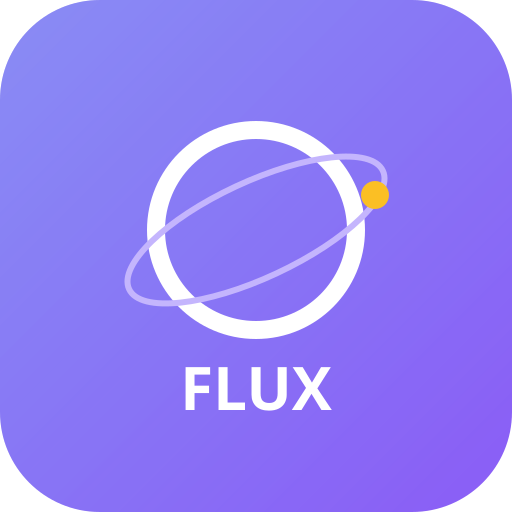

<p align="center">
  
</p>

<h1 align="center">ORION FLUX</h1>
<p align="center"><strong>Autonomous Global Agency OS — AI-Powered Business Automation Platform</strong></p>

<p align="center">
  <a href="https://render.com/deploy?repo=https://github.com/vikaas2030/orion-flux"></a>
</p>

<p align="center">
  36 Global Partner Agencies · 8 Revenue Streams · Real SMTP Outreach · UPI/PayPal Payments · AI Proposals
</p>

---

## 🚀 1-Click Cloud Deploy (Recommended)

Click the **Deploy to Render** button above, or:

1. Go to [render.com](https://render.com) → Sign up free with GitHub
2. Click **New → Blueprint**
3. Connect repo `vikaas2030/orion-flux`
4. Add environment variables (see Configuration below)
5. Click **Deploy** → Live in ~3 minutes with permanent HTTPS URL!

---

## ⚡ Local Quick Start (3 Steps)

**Prerequisites**: [Node.js 18+](https://nodejs.org/)

### Windows
```
Double-click start.bat
```

### Mac / Linux
```bash
chmod +x start.sh && ./start.sh
```

### Manual Start
```bash
# 1. Install dependencies
cd client && npm install && cd ../server && npm install && cd ..

# 2. Build frontend
cd client && npm run build && cd ..

# 3. Start the app
cd server && node app.js
```

Then open **http://localhost:5000** in your browser.

---

## 🌟 Platform Features

### 🏢 Agency Operations
| Module | Description |
|--------|-------------|
| 📊 **Executive Dashboard** | Real-time revenue metrics, QA pipeline, activity feed |
| 🤖 **Agency OS (Solene AI)** | Multi-agent orchestrator with memory & workflows |
| 🌐 **Global Partner Network** | 36 bilateral-bonded agencies across 20+ countries |
| 💰 **8-Stream Revenue Engine** | Diversified income: SEO, Web Dev, AI Video, Voice AI, White-Label & more |

### 🎯 Client Acquisition
| Module | Description |
|--------|-------------|
| 🔍 **Autonomous Lead Hunter** | Real B2B discovery from Google Maps, web search, industry databases |
| 📧 **Real SMTP Outreach** | Gmail-authenticated campaigns with open/click tracking |
| 📝 **AI Proposal Generator** | Gemini-powered custom proposals per client |
| 📱 **Omnichannel Engine** | WhatsApp, Voice, Email — staged follow-up cadence |
| 🔥 **Hot Intent Radar** | Detects high-intent signals for priority closing |

### 💳 Payments & Finance
| Module | Description |
|--------|-------------|
| 💰 **Universal Checkout** | Client portal with dynamic UPI QR + PayPal |
| 🏦 **Bank Reconciliation** | Tracks real UPI settlements to `9690973030@ibl` |
| 📊 **Multi-Stream Income Matrix** | Verified realized bank income vs target capacity |
| 🔐 **Escrow & Retainer Engine** | Contract-based milestone payments |

### 🎬 Creative & Delivery
| Module | Description |
|--------|-------------|
| 🎬 **CineFlow Video Studio** | AI-powered cinematic video production |
| 🚀 **Autonomous Delivery Factory** | Auto-generates client deliverables |
| 📋 **Project Management** | Task tracker with QA pipeline & compliance |

---

## 📱 Install as App (PWA)

ORION FLUX works as a **Progressive Web App**:

1. Click the **Install** icon in browser's address bar
2. Or on mobile: tap **"Add to Home Screen"**
3. Runs like a native application — no browser chrome!

---

## ☁️ Deploy Options

### Render.com (Recommended — Free Tier)
[](https://render.com/deploy?repo=https://github.com/vikaas2030/orion-flux)

### Docker
```bash
docker build -t orion-flux .
docker run -p 5000:5000 --env-file server/.env orion-flux
```

### Railway / Fly.io
```bash
# Railway
railway init && railway up

# Fly.io
fly launch && fly deploy
```

---

## 🔧 Configuration

Copy `.env.example` to `server/.env`:

| Variable | Description | Required |
|----------|-------------|----------|
| `PORT` | Server port (default: 5000) | ✅ |
| `GMAIL_USER` | Gmail address for SMTP outreach | ✅ |
| `GMAIL_APP_PASSWORD` | Gmail app password ([Generate here](https://myaccount.google.com/apppasswords)) | ✅ |
| `GEMINI_API_KEY` | Google Gemini API key for AI features | Optional |
| `NODE_ENV` | Set to `production` for cloud deploy | ✅ |
| `AUTO_TUNNEL` | Set to `false` on cloud (tunnel not needed) | Cloud only |

---

## 🏗️ Tech Stack

- **Frontend**: React 18 + Vite + Chart.js + Glassmorphism UI
- **Backend**: Node.js 20 + Express + Real SMTP
- **Database**: JSON file storage (zero config, zero cost)
- **Payments**: UPI (India) + PayPal (International)
- **AI**: Google Gemini API for proposals & content
- **PWA**: Service Worker + Web App Manifest
- **Cloud**: Render.com / Docker / Railway ready

---

## 📂 Project Structure

```
orion-flux/
├── client/                  # React 18 frontend (Vite)
│   ├── src/
│   │   ├── pages/           # Dashboard, CRM, Proposals, etc.
│   │   ├── components/      # Sidebar, Header, Layout
│   │   └── context/         # Theme provider
│   ├── public/              # PWA manifest, icons
│   └── dist/                # Production build
├── server/                  # Express backend
│   ├── app.js               # Main server + autonomous heartbeat
│   ├── routes/              # API endpoints (20+ route files)
│   ├── services/            # 60+ autonomous engine modules
│   │   ├── eternalHeartbeat.js          # 5-min autonomous cycle
│   │   ├── globalPartnerEngine.js       # 36 partner agencies
│   │   ├── multiStreamRevenue.js        # 8 revenue streams
│   │   ├── autonomousOmnichannelEngine.js # WhatsApp/Voice/Email
│   │   ├── bankReconciliationEngine.js  # UPI settlement tracking
│   │   └── ...
│   └── config/              # Database configuration
├── deliverables/            # Client staging websites
├── database/                # JSON data store (gitignored)
├── Dockerfile               # Multi-stage Docker build
├── render.yaml              # Render.com 1-click blueprint
└── README.md
```

---

## 🌍 Global Partner Network (36 Agencies)

Operating across **20+ countries** with bilateral bond agreements:

| Region | Partners |
|--------|----------|
| 🇮🇳 India | GeekyAnts (Bangalore), Techmagnate (Delhi), Pune Digital Hub |
| 🇺🇸 USA | NP Digital (LA), Chicago Tech Partners, Austin Digital |
| 🇬🇧 UK | Kyan (London), Manchester Digital Agency |
| 🇦🇪 UAE | Division (Dubai), Abu Dhabi Digital |
| 🇸🇬 Singapore | First Page Digital |
| 🇯🇵 Japan | Tokyo Creative Agency |
| 🇰🇷 South Korea | Seoul Digital Partners |
| 🇩🇪 Germany | Berlin Digital, Hamburg Creative |
| 🇨🇭 Switzerland | Zurich Tech Partners |
| 🇫🇷 France | Paris Digital Agency |
| 🇳🇱 Netherlands | Amsterdam Digital |
| 🇸🇦 Saudi Arabia | Riyadh Digital Agency |
| 🇶🇦 Qatar | Doha Creative Partners |
| 🇦🇺 Australia | Melbourne Digital, First Page (Sydney) |
| 🇧🇷 Brazil | Cadastra (São Paulo) |
| + More... | Monks, Dentsu, Asiance, and partners worldwide |

---

<p align="center">
  Built with ❤️ by <strong>Vikas Singh</strong> — Founder & Managing Principal, ORION FLUX
</p>
<p align="center">
  <em>UPI: 9690973030@ibl · PayPal: payments@orionflux.agency</em>
</p>
